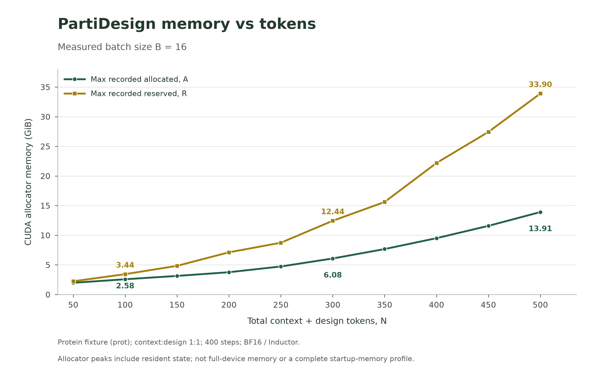
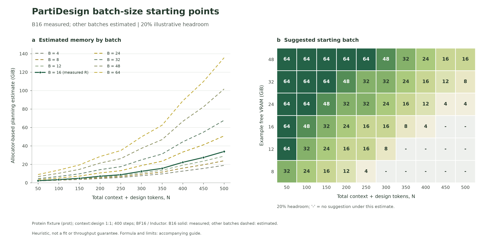

# PartiDesign token-to-batch starting points

Use this guide for **full PartiDesign generation** when batch size is unset.
Candidates: **4, 8, 12, 16, 24, 32, 48, 64**. Only **16** was measured under
this matched recipe; the other batch sizes are estimates, not fastest-batch or
VRAM-fit guarantees.

## Measured reference

Historical protein fixture: `prot` member, flex context, 400 steps, BF16 mixed
precision, compiled Inductor. Total tokens are **context + design**, split 1:1.
Each point has ten formal repeats plus warmup. One resident adapter processed
ascending lengths and retained allocator state. Peak counters were reset before
forward and read after validation; full startup memory is not covered.



| Total tokens | Peak allocated (GiB) | Peak reserved (GiB) |
| ---: | ---: | ---: |
| 50 | 1.98 | 2.24 |
| 100 | 2.58 | 3.44 |
| 150 | 3.14 | 4.84 |
| 200 | 3.76 | 7.12 |
| 250 | 4.73 | 8.74 |
| 300 | 6.08 | 12.44 |
| 350 | 7.67 | 15.61 |
| 400 | 9.51 | 22.20 |
| 450 | 11.59 | 27.44 |
| 500 | 13.91 | 33.90 |

Allocated/reserved are separately maximized PyTorch CUDA counters, not
simultaneous snapshots or whole-device occupancy; their difference is not a
measured cache component. The publication reports RTX4090-48G, but per-record
device identity/capacity was not captured. Do not treat this as a verified
stock-24-GiB RTX4090 fit chart. Exact byte values and source hash are in the
[measured CSV](../assets/performance/partidesign_memory_bs16.csv) and
[provenance](../assets/performance/partidesign_memory_provenance.json).

## Choose a starting candidate

With measured peaks `A` (allocated), `R` (reserved), and `r = batch / 16`, use
this explicit **planning scenario**:

```text
estimated_GiB = r * R + max(1 - r, 0) * A
```

It takes the largest prediction in the assumed family `F+r*(R-F)` for unknown
fixed component `0 <= F <= A`. This does not prove `A` is fixed memory or that
`R-A` scales with batch. Nonlinear workspaces, compilation, retained pools and
changed shapes can break the assumption; it is not a measured upper bound.

For the figure/example, leave **20% of currently free VRAM** as illustrative
headroom. Choose the largest listed candidate with estimate <= 80% of free
VRAM **before the new process loads**. The margin is adjustable planning advice,
not a new CLI/config option or a guarantee against OOM.



Examples under that assumption:

| Total tokens | 24 GiB currently free | 48 GiB currently free |
| ---: | ---: | ---: |
| 100 | 64 | 64 |
| 200 | 32 | 64 |
| 300 | 24 | 48 |
| 400 | 12 | 24 |
| 500 | 4 | 16 |

At N500, B16 has 33.90 GiB recorded reserved; B8 estimates 23.91 GiB and B4
18.91 GiB. The smaller batches are unmeasured. A dash means no listed candidate
is suggested by this scenario; do not force batch4 or declare the model unsupported.

## Apply to the actual run

- Count prepared/cropped **total** model tokens, including retained context;
  use the largest expected shape for variable lengths. Within 50–500, use the
  next measured token point as a lookup convention, not a proven memory bound.
- Use assigned per-device free VRAM; for one common distributed batch, consider
  the most constrained device. Check CPU/RAM/loaders separately. Batch is per
  rank; do not add requested samples to fill it. A batch above pending work
  provides no extra work or throughput by itself.
- Preserve explicit user settings and reproduction protocols. Otherwise use the
  table as a starting proposal within the requested execution scope. More batch
  is not proven faster. Do not add profiling runs, automatic OOM retries or output
  replacement beyond that scope.
- Other modalities/members, context splits, backends/precision, partial diffusion
  and cofold models have no matched calibration here. Above 500 tokens, do not
  extrapolate or crop/clamp the task to 500; use [general guidance](resources.md).
  An unmeasured shape is not a production admission boundary.
- Keep sampling budgets, iteration and criteria unchanged. Use supported
  `--batch-size` or pipeline `generation.batch_size`; this adds no runtime gate
  or VRAM-budget knob.
