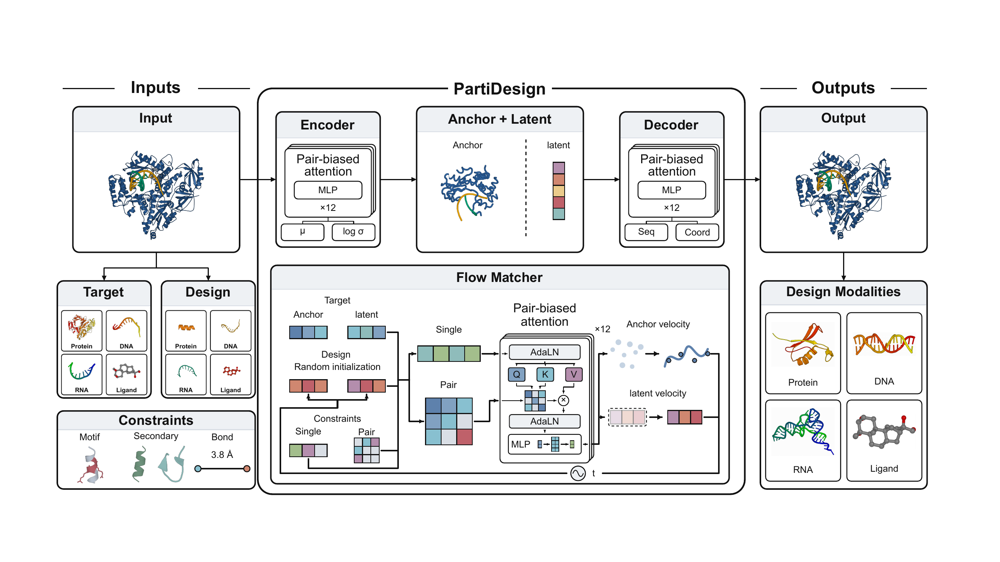
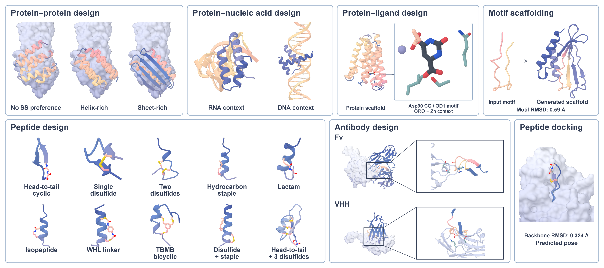
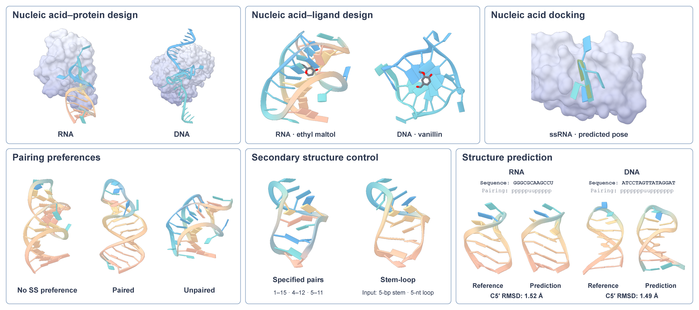
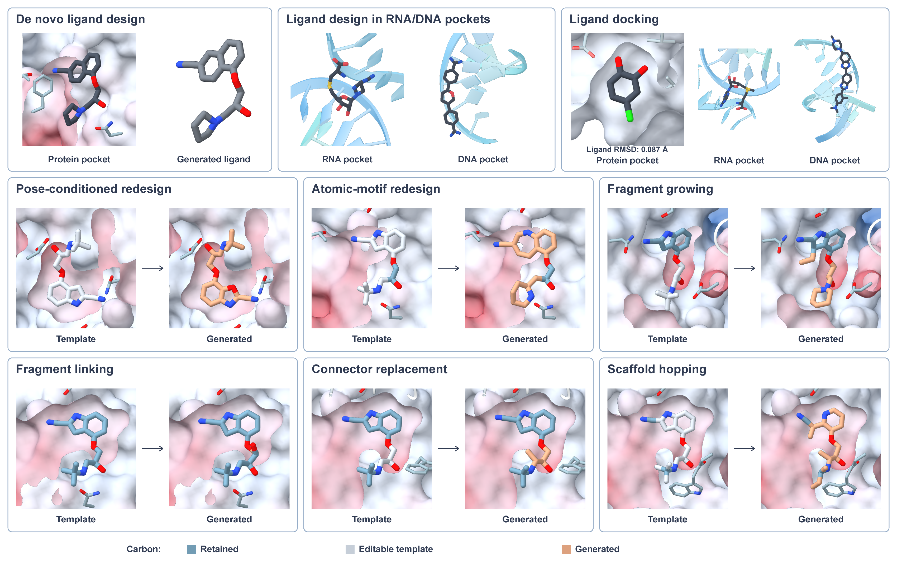
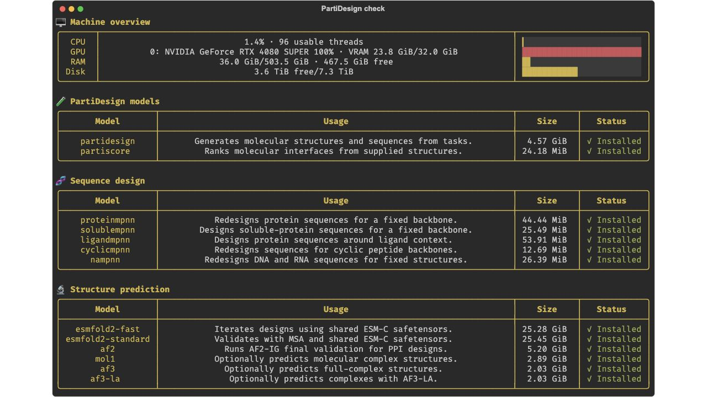
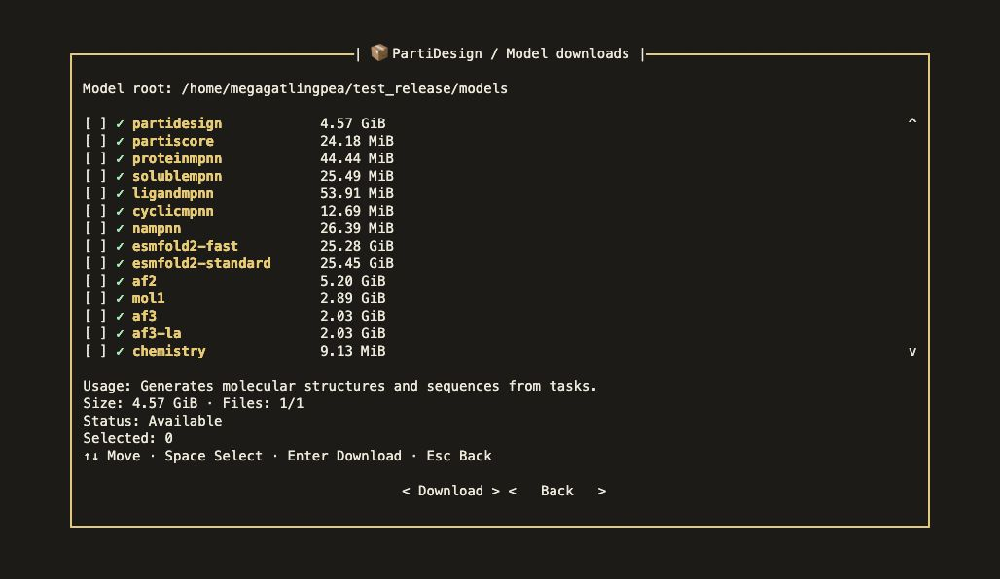
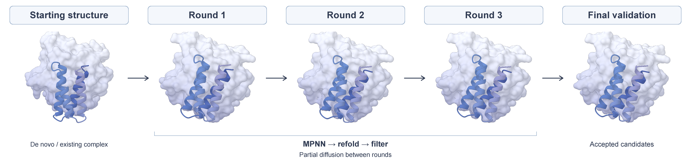

<p align="center">
  
</p>

<h1 align="center">PartiDesign</h1>

<p align="center"><strong>Joint molecular structure and identity generation</strong></p>

<p align="center">
  <a href="https://megagatlingpea.github.io/PartiDesign-official/"></a>
  <a href="https://github.com/MegaGatlingPea/PartiDesign-official"></a>
  <a href="https://cadd.zju.edu.cn/partidesign/"></a>
  <a href="https://doi.org/10.64898/2026.11.03.763860"></a>
  <a href="docs/README.md"></a>
</p>

PartiDesign is an all-atom generative framework for **proteins, peptides, DNA,
RNA and small molecules**. It designs sequences or chemical identities together
with three-dimensional atomic structures. Molecules can be generated on their
own or in protein, nucleic-acid and small-molecule environments.

Combine fixed sequences, residue or atomic motifs, secondary-structure guidance,
hotspots and explicit chemical connections to shape a design. These conditions
support tasks ranging from protein scaffolding and aptamer design to peptide
cyclization, ligand fragment growing and scaffold hopping. Reference-start
partial diffusion explores an existing structure's neighborhood, while the
iterative pipeline connects generation, sequence redesign, refolding and final
validation. **PartiScore** provides an additional molecular-interface score.

<p align="center">
  
</p>

Explore the [project website](https://megagatlingpea.github.io/PartiDesign-official/),
use the [web server](https://cadd.zju.edu.cn/partidesign/) for visual task setup,
or start from the [runnable examples](configs/examples/README.md).

[Capabilities](#capabilities) · [Agent Skill](#agent-skill) · [Installation](#installation) ·
[CLI](#cli) · [Screen](#screen) · [Pipeline](#pipeline) · [Documentation](#documentation) ·
[Citation](#citation) · [Acknowledgements](#acknowledgements) · [License](#license)

## Capabilities

Explore molecular generation, peptide and antibody design, and fixed-identity
docking. Combine the conditions needed for your task.

### Protein

Generate protein monomers and binders with residue or atomic motifs and
secondary-structure guidance. Design linear, cyclic and crosslinked peptides,
or selected CDRs in paired VH/VL or VHH scaffolds. Fixed-identity peptides
support docking.

<p align="center">
  
</p>

[Protein examples](configs/examples/README.md#protein) ·
[Motifs](configs/examples/README.md#motifs) ·
[Peptide examples](configs/examples/README.md#peptide-topologies) ·
[Peptide tasks](configs/examples/peptide.yaml) ·
[Antibody examples](configs/examples/README.md#antibodies) ·
[Chemical bonds](docs/task_schema.md#explicit-bonds)

### Nucleic acids

Design DNA and RNA aptamers around proteins or small molecules, or generate
structures for fixed sequences. Combine paired/unpaired, specified-pair and
stem-loop guidance with sequence and motif conditions. Fixed-identity ssRNA
supports docking.

<p align="center">
  
</p>

[Nucleic-acid examples](configs/examples/README.md#nucleic-acids) ·
[ssRNA tasks](configs/examples/nucleic_acids.yaml)

### Small molecules

Generate pocket-conditioned ligands, grow or link retained fragments, and
explore scaffold changes. Fixed-identity ligands support docking in protein or
nucleic-acid context.

<p align="center">
  
</p>

[Ligand examples](configs/examples/README.md#ligands) ·
[Small-molecule tasks](configs/examples/ligand.yaml) ·
[Docking examples](configs/examples/README.md#docking)

## Agent Skill

**We recommend using a coding agent with the
[PartiDesign MilkyFrog skill](.agents/skills/partidesign-milkyfrog/SKILL.md).**
It helps set up the environment, prepare model downloads, adapt task YAML to
your molecules and constraints, and run or troubleshoot design workflows.

Give your agent this repository and the linked skill. In Codex opened from the
checkout, you can start with:

```text
Use $partidesign-milkyfrog to set up PartiDesign, download the models needed
for the insulin receptor pipeline demo, and help me adapt a task to my target.
```

The same skill covers partial diffusion, existing-structure optimization,
validation, relax, postfiltering, clustering and result interpretation.

## Installation

Use Linux with an NVIDIA GPU, [uv](https://docs.astral.sh/uv/getting-started/installation/)
(version 0.11.17 or later), and Mamba or Conda (for example, Miniforge).
From your working directory:

```bash
git clone --depth 1 --branch main https://github.com/MegaGatlingPea/PartiDesign-official.git
cd PartiDesign-official
bash install.sh
source .venv/bin/activate
```

The Bash installer defaults to **uv and CUDA 12**. The Conda/pip route remains
available explicitly:

```bash
bash install.sh --installer conda --cuda 12
conda activate partidesign
```

The uv route creates a paired native Conda prefix for OpenMM/OpenFF, AmberTools
and build tools, then installs the project and model Python packages into the
locked `.venv`. Keep both directories together; activating the native prefix
separately is unnecessary. See the [uv setup and recovery guide](docs/environments.md#install-with-uv)
for CUDA 13, explicit paths and retries. `full` uses uv's private source mappings;
`pip install .[full]` is not an equivalent installation command.

The installer shows a stage table with elapsed time and streams Python-package
download, build and installation output. It reads the supplied environment YAML, keeping
the same package versions. For CUDA 13, use separate uv paths:

```bash
bash install.sh --cuda 13 --venv .venv-cu13 \
  --native-prefix .cache/environments/native-cu13
source .venv-cu13/bin/activate
```

If Python-package installation stops, resume with the same installer and profile:

```bash
bash install.sh --cuda 12 --pip-only
# Or, for an existing Conda/pip installation:
bash install.sh --installer conda --cuda 12 --pip-only
```

Repeat custom uv paths on retries. If native environment creation was
interrupted, use `--update` instead. Keep the environment
and package caches: uv and pip can reuse completed cached downloads and skip
satisfied packages, though an interrupted download or local source build may
restart. See [installation recovery](docs/environments.md#resume-an-interrupted-install)
for both CUDA profiles and cache settings.

Update a checkout with no local code changes using `git pull --ff-only`, then
update its environment with the same installer and CUDA profile. See the
[environment guide](docs/environments.md) for recovery and CUDA profiles.

## CLI

```bash
partidesign check     # machine overview and model status
partidesign download  # interactive model download
```

For scripts: `partidesign download partidesign partiscore`. Both checkpoints
come from [Hugging Face](https://huggingface.co/MegaGatlingPea/PartiDesign).

| Model | Usage | Model | Usage |
| --- | --- | --- | --- |
| `partidesign` | Generates molecular structures and sequences from tasks. | `partiscore` | Ranks molecular interfaces from supplied structures. |
| `proteinmpnn` | Redesigns protein sequences for a fixed backbone. | `solublempnn` | Designs soluble-protein sequences for a fixed backbone. |
| `ligandmpnn` | Designs protein sequences around ligand context. | `cyclicmpnn` | Redesigns sequences for cyclic peptide backbones. |
| `nampnn` | Redesigns DNA and RNA sequences for fixed structures. | `boltz2` | Predicts protein–ligand structures and binding affinity. |
| `esmfold2-fast` | Iterates designs using shared ESM-C safetensors. | `esmfold2-standard` | Validates with MSA and shared ESM-C safetensors. |
| `af2` | Runs AF2-IG final validation for PPI designs. | `mol1` | Optionally predicts molecular complex structures. |
| `af3` | Optionally predicts full-complex structures. | `af3-la` | Optionally predicts complexes with AF3-LA. |

Fast and standard share the same ESM-C safetensors.
For Boltz-2 structure prediction and native ligand affinity, use the single
`partidesign download boltz2` target; assets live under `community_models/boltz/`.

See [check](docs/check.md) and [downloads](docs/download.md) for details.

<details>
<summary>CLI previews</summary>





</details>

## Screen

Predict supplied protein, peptide, RNA, DNA or ligand candidates against shared
sequence contexts, then rank their native representatives:

```bash
partidesign screen configs/examples/screen.yaml --task ligand_screen \
  --out screen_results/ligand --plan
```

The CSV uses `id,modality,seq`; ligand `seq` values are SMILES. Screen and pipeline
share prediction backends and `--worker-cpus` / `--worker-gpus` controls.
Remove `--plan` to run. See the [screen guide](docs/screen.md) for methods,
context MSA/templates, pockets, native affinity and ranking.

## Pipeline

**One command for de novo design and structure-guided redesign.**
`partidesign pipeline` brings diffusion, partial diffusion, MPNN sequence
redesign, refolding and final validation into one runner. Start from a task YAML
or from existing complexes annotated with their design chains and conditions.

<p align="center">
  
</p>

Start with your first **insulin receptor binder design** using the bundled PPI demo:

```bash
partidesign pipeline configs/examples/pipeline_tasks.yaml \
  --task protdbench_insulin_receptor --preset ppi \
  --config configs/pipeline/demo.yaml --run-name insulin_receptor_demo
```

The demo runs three rounds with ESMFold2-fast, relaxed pipeline screening and
partial diffusion. Final validation uses only AF2-IG: models 1 and 2 each predict
one matched complex/monomer pair, and both pairs must pass.
Fixed identities, motifs and chemical connections remain part of the task.

For ordinary final validation with **ESMFold2-standard and context MSA**, use
the protein preset:

```bash
partidesign download esmfold2-fast esmfold2-standard solublempnn
partidesign pipeline configs/examples/pipeline_tasks.yaml \
  --task protdbench_insulin_receptor --preset protein \
  --run-name insulin_receptor_standard
```

Standard retrieves or reuses MSA for fixed protein context without templates;
designed chains remain query-only. AF3 and Mol-1 are explicitly optional.

Or optimize the bundled **linear and cyclic peptide complexes**:

```bash
partidesign pipeline configs/examples/optimization \
  --config configs/pipeline/optimize.yaml --preset ppi \
  --run-name peptide_optimization
```

The directory's `annotation.csv` describes each starting complex. This workflow
begins with partial diffusion and uses the selected preset's final validator;
prepare its [evaluation models](docs/download.md#optional-evaluation-models).
Add `--plan` to preview either command without starting model jobs.

For **GLP1R VHH design or optimization**, use the antibody preset:

```bash
partidesign pipeline configs/examples/antibody.yaml --task glp1r_vhh_bindcraft2 --preset antibody --run-name glp1r_vhh_denovo
partidesign pipeline configs/examples/antibody_opt --preset antibody --run-name glp1r_vhh_optimization
```

The bundled [five seed complexes](configs/examples/antibody_opt/annotation.csv) carry
native CDR/framework permissions and an independent paratope declaration.
ESMFold2-fast drives iteration; final validation predicts each selected sequence
five times with ESMFold2-standard, then applies geometry and antigen-contact
criteria to the best prediction ranked by 0.8 ipTM + 0.2 pTM. See [antibody pipelines](docs/pipeline.md#antibody-pipelines).

Accepted candidates are in `inference/<run>/<task>/final/success/`.
Ligand design automatically selects the ligand preset: one Boltz-2 round
and Boltz-2 final structure validation with native affinity. Preview the bundled
ligand task with:

```bash
partidesign pipeline configs/examples/ligand.yaml --task ligand_fixture \
  --preset ligand --run-name ligand_pipeline --plan
```

See the [pipeline guide](docs/pipeline.md) for presets, candidate counts,
per-round settings, annotation fields and resume.

## Documentation

| Guide                                 | Contents                                                                  |
| ------------------------------------- | ------------------------------------------------------------------------- |
| [User guide](docs/README.md)           | Reading order and all documentation                                       |
| [Generation](docs/design.md)           | First run, task selection, execution settings and outputs                 |
| [Screen](docs/screen.md)               | Rank supplied sequences and SMILES against shared contexts                |
| [Pipeline](docs/pipeline.md)           | De novo design, existing-structure optimization and final filters         |
| [Task YAML](docs/task_schema.md)       | Molecules, sequences, motifs, secondary structure and chemistry           |
| [Commands](docs/commands.md)           | Generation, MSA, scoring, relax, validation, postfiltering and clustering |
| [Partial diffusion](docs/partial.md)   | Sampling around a reference structure                                     |
| [Examples](configs/examples/README.md) | Runnable tasks by modality and topology                                   |
| [Performance](docs/performance.md)     | Computational budgets, evaluation protocols and task-level results        |

The [interactive notebook](partidesign.ipynb) supports visual task editing.

## Citation

If you use PartiDesign in your research, please cite our [bioRxiv preprint](https://doi.org/10.64898/2026.11.03.763860):

```bibtex
@article{jin2026partidesign,
  title = {{PartiDesign}: A structure-sequence co-design paradigm for practical all-to-all biomolecules design},
  author = {Jin, Zichang and Zhang, Xujun and Kang, Yu and Hou, Tingjun},
  journal = {bioRxiv},
  year = {2026},
  doi = {10.64898/2026.11.03.763860},
  url = {https://doi.org/10.64898/2026.11.03.763860}
}
```

## Acknowledgements

We thank the developers of [La-Proteina](https://github.com/NVIDIA-BioNeMo/la-proteina),
[ODesign](https://github.com/OTeam-AI4S/ODesign),
[Protenix](https://github.com/bytedance/Protenix), and
[ColabFold](https://github.com/sokrypton/ColabFold) for sharing their code and tools
with the community.

We also thank the [HalluDesign](https://github.com/MinchaoFang/HalluDesign) team
for sharing their iterative sequence–structure co-optimization framework, which
inspired the design of PartiDesign's pipeline workflow.

Special thanks to Codex and Tibo — we couldn't have tackled this mountain of work
without you! 🐸

<p>
  
</p>

## License

PartiDesign source code is released under the [Apache 2.0 License](LICENSE).
Third-party source licenses are kept beside their code under
[community_models/](community_models/), with additional [licenses and notices](licenses/).
Resource licenses are kept under [configs/resources/](configs/resources/).
Model weights remain subject to their upstream terms.

**AlphaFold 3 model parameters and outputs are restricted to non-commercial use**
under Google's [Model Parameters Terms of Use](https://github.com/google-deepmind/alphafold3/blob/main/WEIGHTS_TERMS_OF_USE.md).
These terms apply when AF3 is explicitly selected.
Mol-1 has separate upstream source and parameter terms.
