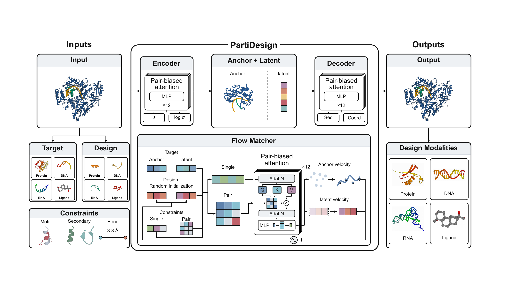
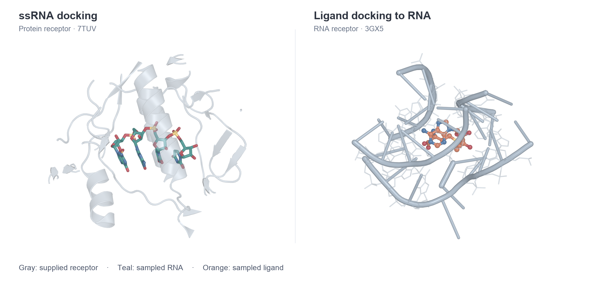
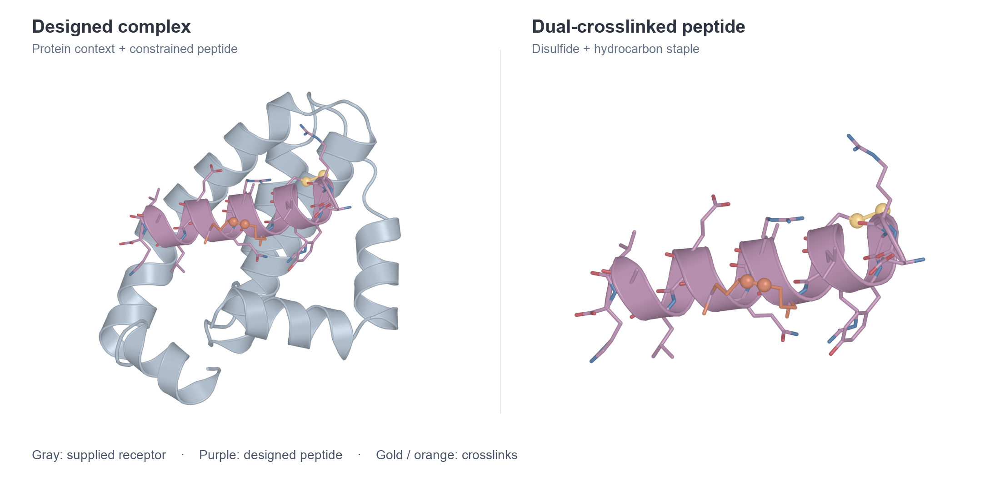
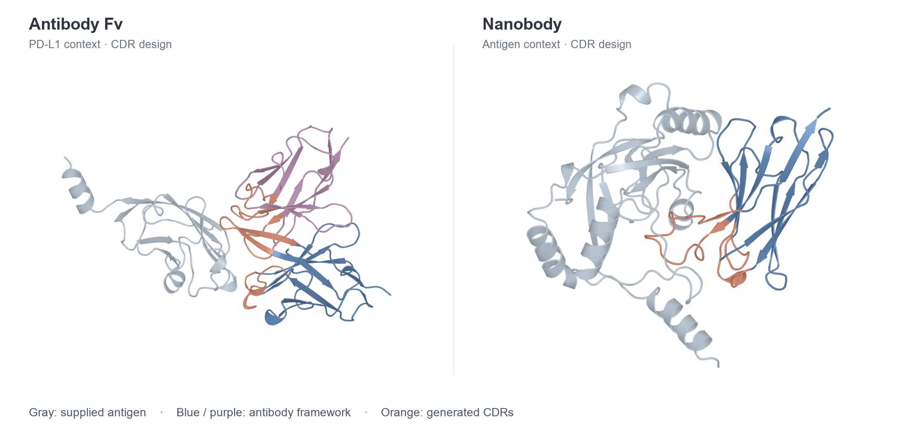

<p align="center">
  
</p>

<h1 align="center">PartiDesign</h1>

<p align="center"><strong>Joint molecular structure and identity generation</strong></p>

<p align="center">
  <a href="https://cadd.zju.edu.cn/partidesign/"></a>
  <a href="docs/README.md"></a>
</p>

PartiDesign generates molecular structures together with their sequences or
chemical identities. It supports proteins, DNA, RNA, and small molecules, with
protein, nucleic acid, or ligand context. Sequence, structural, secondary-structure,
and chemical conditions can be combined in one request.

Use the [web server](https://cadd.zju.edu.cn/partidesign/) for visual task setup,
or run the inference, scoring, refinement, and evaluation tools in this repository.

- [Installation](#installation)
- [Inference](#inference)
- [Usage](#usage)
- [Computational budget](#computational-budget)
- [Documentation](#documentation)
- [Agent skill](#agent-skill)
- [Acknowledgements](#acknowledgements)
- [License](#license)

<p align="center">
  
</p>

Spatial anchors and learned local latents represent geometry and molecular
identity in a shared space. Flow matching generates both together, and the
decoder recovers identities and atom coordinates. **PartiScore**, an MDN network
for molecular interface scoring, can score the resulting complexes.
Optional workflow steps include Best-of-N ranking, OpenMM refinement, MPNN
sequence redesign, refolding, protein-complex postfiltering, and structural
clustering.

## Installation

**Step 1 — Create the environment**

Use Linux with an NVIDIA GPU and Conda or a compatible environment manager. The
supplied environment uses **Python 3.12.6, CUDA 12.8, and PyTorch 2.9.1+cu128**.
GPU memory requirements depend on molecule size, batch size, and validation model.

Run environment creation from the repository root:

```bash
git clone https://github.com/MegaGatlingPea/PartiDesign-official.git
cd PartiDesign-official

conda env create -f partidesign_cu12.yaml
conda activate partidesign
partidesign --help
```

For the full CUDA 13 environment, including the optional BioIR backend, use
`conda env create -f partidesign_cu13.yaml` and `conda activate partidesign_cu13`
instead. It includes the same redesign, folding, MSA, chemistry, refinement and
docking tools. CUDA 13 requires Linux x86_64, glibc 2.34 or newer, and NVIDIA
driver 580 or newer. See the [environment guide](docs/environments.md).

Both environment definitions support PyRosetta, DSSP, and DAlphaBall for CPU
postfiltering of successful protein complexes. See the
[postfilter installation guide](docs/postfilter.md#dependencies-and-execution-settings).

The environment definition installs PartiDesign, bundled backend sources, and
build dependencies. Check the active Python/PyTorch environment and GPU:

```bash
python -c "import sys, torch; print('Python:', sys.version.split()[0]); print('PyTorch:', torch.__version__); print('CUDA build:', torch.version.cuda); print('CUDA available:', torch.cuda.is_available())"
nvidia-smi
```

**Step 2 — Prepare model weights and check the installation**

Download **[partidesign.ckpt from Google Drive](https://drive.google.com/file/d/19j8aaysxeQlT0RI5URrQm3A9uWdqSE5e/view?usp=sharing)**
(about 4.91 GB). Open the link, choose **Download**, and save the file under
`ckpts/` beside the included PartiScore checkpoint:

```text
ckpts/
├── partidesign.ckpt   # Download from the link above
└── partiscore.ckpt    # Included in the clone
```

For a terminal download, run from the repository root:

```bash
python -m pip install gdown
gdown 'https://drive.google.com/file/d/19j8aaysxeQlT0RI5URrQm3A9uWdqSE5e/view?usp=sharing' \
  -O ckpts/partidesign.ckpt
```

Keep the downloaded `.ckpt` file intact; it does not need to be extracted. To
store it elsewhere, select it with `--ckpt FILE`. The `partidesign download`
command does not yet fetch this Drive release automatically; see the
[download guide](docs/download.md#generation-weights-and-bundled-assets) for
other model assets and separate model storage.

PartiScore, CyclicMPNN, and native chemistry resources are included in the clone.
Inspect model availability and check the bundled resources:

```bash
partidesign download --list
partidesign check --model chemistry --model partiscore --load
partidesign check --model partiscore --smoke
```

The last command runs a small, real PartiScore inference check on CPU. It does
not require the generation checkpoint, and temporary outputs are removed unless
`--out PATH` is supplied. These CPU checks are separate from GPU readiness.

The first generation example needs no additional prediction or redesign models.
See [optional evaluation models](docs/download.md#optional-evaluation-models),
[separate model storage](docs/download.md#use-a-separate-model-directory), and
[installation troubleshooting](docs/check.md#installation-and-first-run-troubleshooting)
for other workflows.

## Inference

### Input format

A YAML file contains named tasks describing what to generate and what to retain.
Start from a file in [configs/examples](configs/examples/README.md), select a task
with `--task`, and edit its inputs and conditions using the
[Task YAML reference](docs/task_schema.md).

### Run inference


Run the examples from the repository root with your selected PartiDesign
environment active. The `protein_fixture` task requests five proteins of length
40, with scoring and refinement disabled. Preview the configuration without loading weights:

```bash
partidesign design configs/examples/protein.yaml \
  --task protein_fixture --run-name first_run \
  --batch-size 1 --show-config
```

After supplying the generation checkpoint, check the task and generate:

```bash
partidesign check configs/examples/protein.yaml --task protein_fixture

CUDA_VISIBLE_DEVICES=0 partidesign design configs/examples/protein.yaml \
  --task protein_fixture --run-name first_run \
  --batch-size 1
```

Execution and compilation default to `auto`. A submission with at least 100
expanded candidates uses native dynamic compilation. Smaller submissions use
BioIR when usable, or native eager execution when it is unavailable. BioIR uses
CUDA Graphs for eligible inputs and its eager kernels otherwise. The count
includes selected tasks, length plans, `sample_num`, and Best-of-N replicas;
batch size does not change it. See [execution settings](docs/design.md#execution-and-compilation).

### Output format

Results are written to one directory per task:

```text
inference/first_run/protein_fixture/
  resolved_config.yaml
  result.csv
  logs/design.log
  sample1.cif
  ...
```

Use a new run name or output root for each run; selected task directories must
be new or empty. If a sample has no structure file, inspect `result.csv` and the
log. For your own task, copy a request from the [example index](configs/examples/README.md)
and edit its inputs, sample count, and conditions using the
[Task YAML reference](docs/task_schema.md).

### Common options

| Common option | Purpose |
| --- | --- |
| `--task NAME` | Select a named task from the YAML file |
| `--run-name NAME` | Write under `inference/NAME/` |
| `--out PATH` | Set an explicit output root |
| `--batch-size N` | Set the generation batch size |
| `--execution-backend auto\|native\|bioir` | Select execution; default `auto` |
| `--compile auto\|true\|false` | Select native compilation; default `auto` |
| `--compile-strategy auto\|dynamic\|bucket` | Select automatic, dynamic, or bucket compilation |
| `--show-config` | Print resolved settings without generating |

The [generation guide](docs/design.md) covers all options. Separate guides explain
[scoring](docs/score.md), [refinement](docs/relax.md),
[validation](docs/validate.md), [postfiltering](docs/postfilter.md), and
[clustering](docs/cluster.md).
Normal and antibody tasks should be submitted separately.

## Usage

### Protein design

Design protein binders for protein, nucleic-acid, or ligand targets, or generate
proteins without a receptor. Hotspots focus the intended interface; α/β conditions
guide secondary structure. Backbone, full-residue, and partial-atom motifs can be
retained for motif scaffolding and atomic motif scaffolding around a ligand (AME).

**Examples:** [Protein design](configs/examples/README.md#protein) ·
[Motif scaffolding](configs/examples/README.md#motifs)

### DNA and RNA design

Generate RNA or DNA aptamers around proteins and ligands, or design monomers
without receptor context. Tasks also support fixed-sequence folding, backbone-
conditioned identity redesign, base/all-atom motifs, and paired/unpaired or
explicit base-pair conditions.

**Examples:** [Nucleic acid design](configs/examples/README.md#nucleic-acids)

### Ligand design

Generate ligand chemistry and coordinates in a protein pocket. Partial chemistry
conditions support scaffold hopping and generation around selected source atoms;
a complete fixed identity specifies a docking task.

**Examples:** [Ligand design](configs/examples/README.md#ligands) ·
[Ligand identity modes](docs/task_schema.md#ligand-identity-modes)

### Docking (Preview)

Inference is available for fixed-identity ligand, peptide, and ssRNA docking.
Docking remains under active development, and pose quality can vary across targets.
The views below show ssRNA on a protein receptor (7TUV, left) and a ligand in an
RNA receptor (3GX5, right). Receptors are gray and generated poses are colored.

<p align="center">
  
</p>

**Examples:** [Docking tasks](configs/examples/README.md#docking-preview)

### Peptide design with multiple topologies (Preview)

Inference supports linear, head-to-tail cyclic, disulfide, lactam/isopeptide,
stapled, and bicyclic peptides. These workflows are still being developed, and
current results can be inconsistent for some targets or constraints.

The 18-residue example below combines fixed cysteines, MK8 anchors, a helical
condition, and disulfide and hydrocarbon crosslinks. The views show the
OpenMM-refined complex and isolated peptide from Figure 2 of the paper.

<p align="center">
  
</p>

**Examples:** [Peptide topologies](configs/examples/README.md#peptide-topologies-preview) ·
[Explicit bonds](docs/task_schema.md#explicit-bonds)

### Antibody CDR design (Preview)

Inference supports selected-CDR design in paired VH/VL and VHH frameworks, with
optional antigen context. Antibody design remains under active development;
current outputs may fall short of expectations on some targets.

Shown below are paired VH/VL designs with PD-L1 context (left) and VHH designs
with antigen context (right). CDR1–3 are designed while framework identities
remain fixed. Orange marks CDRs, blue/purple marks frameworks, and gray marks antigen.

<p align="center">
  
</p>

**Examples:** [Antibody tasks](configs/examples/README.md#antibodies-preview)

The three Preview workflows are available for inference today. Their images are
computational examples, without experimental binding validation or performance
comparisons here. Tasks can jointly generate multiple chains and combine fixed
or excluded identities, retained motifs, secondary structure, hotspots, and
chemical bonds. All supported task fields are documented in the
[Task YAML reference](docs/task_schema.md), including
[sequence identities](docs/task_schema.md#sequence-identity),
[secondary structure](docs/task_schema.md#secondary-structure), and
[hotspots and context](docs/task_schema.md#selectors-crop-and-hotspots).

## Computational budget

The paper estimates passing outputs under **24 hours on one RTX 4090-48G GPU
per case**. Counts are averaged equally across cases and rounded to whole outputs.
**Self** uses PartiDesign's generated sequence or chemical identity.

| Task | Self: normal | Self: guided |
| --- | ---: | ---: |
| Protein binders / ProtDBench | 9,938 | 16,459 (α) |
| Atomic motif scaffolding / AME | 1,561 | 2,238 (α) |
| Proteins for RNA/DNA | 711 | 685 (α) |
| Proteins for ligands | 3,491 | 2,897 (α) |
| RNA/DNA aptamers for proteins | 2,498 | 2,383 (paired) |
| RNA/DNA aptamers for ligands | 28,485 | 25,229 (paired) |
| Ligands: five pockets | 1,793–64,126 across pockets | — |

Polymer estimates include generation and the stated structure-validation costs.
Ligand estimates charge GPU generation only, excluding CPU chemical scoring and
docking. These computational passing estimates do not measure experimental
binding rates or end-to-end throughput.

**Full results:** [Evaluators, complete budgets, sequence protocols, and task-level figures](docs/performance.md)

## Documentation

| Guide | Contents |
| --- | --- |
| [User guide](docs/README.md) | Documentation overview and reading order |
| [Task YAML](docs/task_schema.md) | Task fields, molecules, lengths, constraints, and antibody CDRs |
| [Commands](docs/commands.md) | A separate reference page for each CLI command |
| [Validation](docs/validate.md) | Methods, MPNN sequence sources, passing criteria, reports, reuse, and reruns |
| [Postfilter](docs/postfilter.md) | Rosetta relaxation, BC1/BC2 protein metrics, filtering and recovery for successful refolds |
| [Example index](configs/examples/README.md) | Named runnable tasks by modality and topology |
| [Performance](docs/performance.md) | Complete budget tables, definitions, and evaluation scope |

The [interactive notebook](partidesign.ipynb) supports visual task editing with
the `partidesign` environment. [Benchmark configurations](configs/benchmarks/)
contain the task and protocol definitions used for evaluation.

## Agent skill

The **[PartiDesign MilkyFrog skill](.agents/skills/partidesign-milkyfrog/SKILL.md)**
helps with task YAML, generation, scoring, refinement, validation, protein-complex
postfiltering, clustering, troubleshooting, and usage questions. In Codex opened
from this checkout,
invoke it by name, for example:

```text
Use $partidesign-milkyfrog to prepare a protein binder task and a validation plan.
```

The skill uses the active installation's commands and documentation. It can
prepare configurations or answer questions without starting model jobs.

## Acknowledgements

We thank the developers of [La-Proteina](https://github.com/NVIDIA-BioNeMo/la-proteina),
[ODesign](https://github.com/OTeam-AI4S/ODesign),
[Protenix](https://github.com/bytedance/Protenix), and
[ColabFold](https://github.com/sokrypton/ColabFold) for sharing their code and tools
with the community.

Special thanks to Codex and Tibo — we couldn't have tackled this mountain of work
without you! 🐸

<p>
  
</p>

## License

PartiDesign source code is released under the [Apache 2.0 License](LICENSE).

Third-party source licenses are kept beside their code under `community_models/`.
Resource licenses are kept under `configs/resources/`. Model weights are subject
to their upstream terms.
