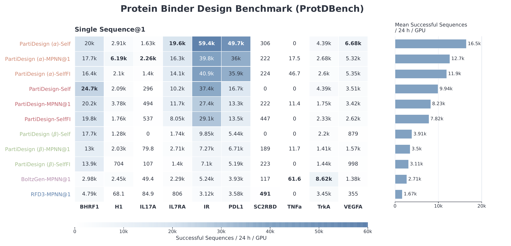
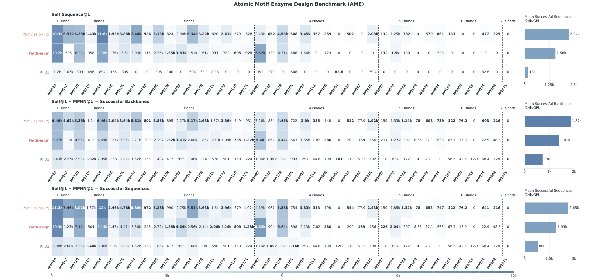
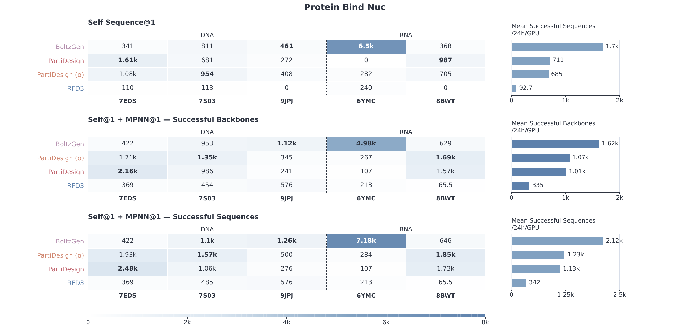
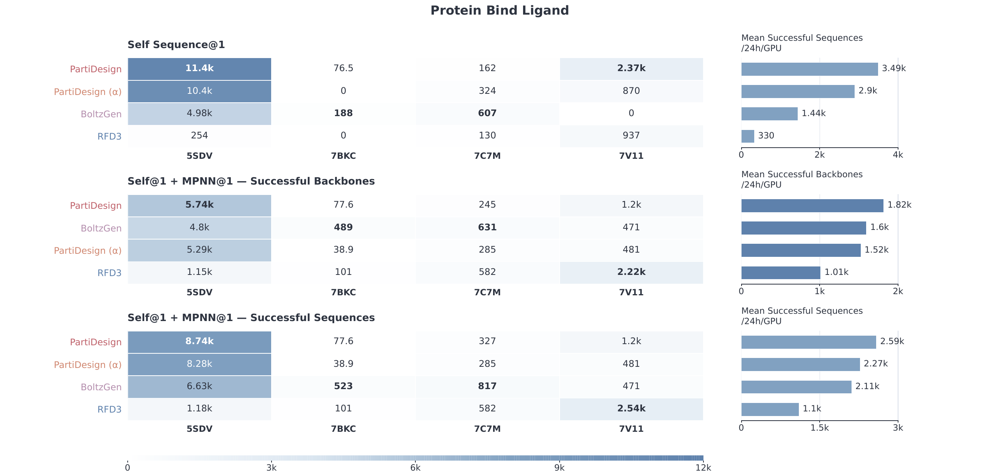
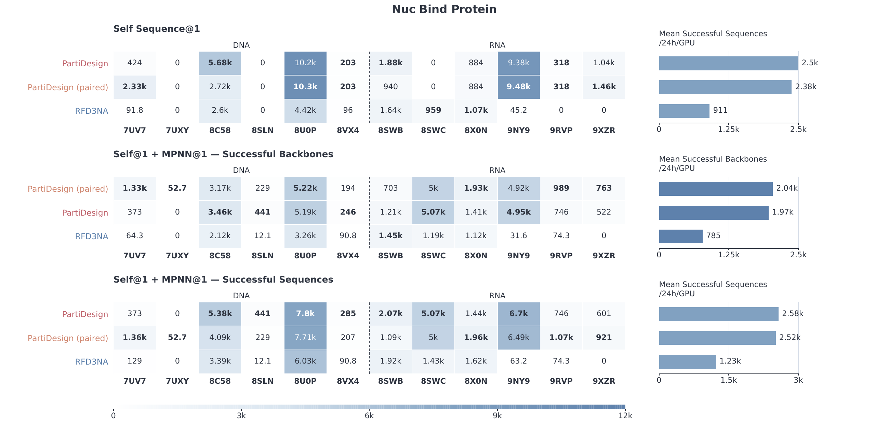
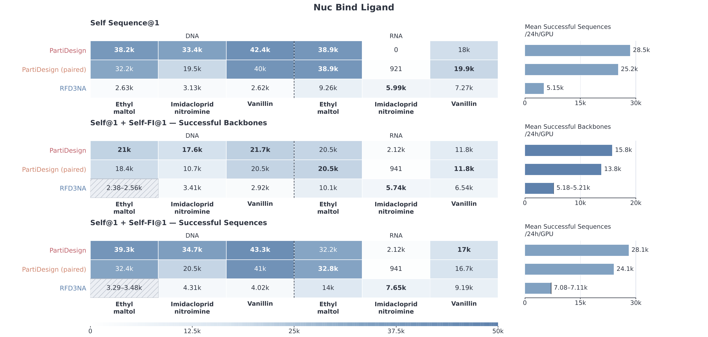
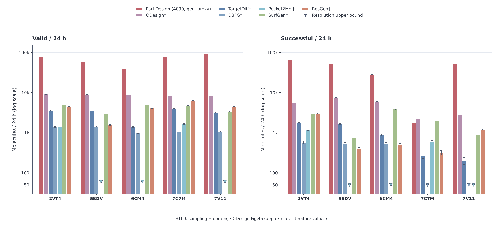

# Computational budget and performance

This page collects the full compute-budget tables and task-specific figures.
The main [README](../README.md#computational-budget) contains a shorter summary.

## Budget summary

The estimates allocate **one RTX 4090-48G GPU for 24 hours to each case**. Each
case's passing output is estimated separately, then cases receive equal weight
in the average. Counts are rounded to whole outputs. For polymers, the budget
combines generation, any specified sequence redesign, and complete structure
prediction with the task's passing criteria. These are computational screening
estimates; they do not measure experimental binding or end-to-end service
throughput.

### Directly generated identities: Self

**Self** evaluates the sequence or identity generated directly by PartiDesign.
The polymer entries below are passing sequences per GPU-day; each is also a
successful backbone because only one sequence is screened.

| Task | Self: normal | Self: guided | Validation used in the budget |
| --- | ---: | ---: | --- |
| [Protein-binding protein binders / ProtDBench](#protein-binding-protein-binders) | 9,938 | 16,459 (α) | AF2-IG-Easy |
| [Atomic motif scaffolding / AME](#atomic-motif-scaffolding--ame) | 1,561 | 2,238 (α) | ESMFold2-standard + motif criteria |
| [Nucleic acid-binding protein binders](#nucleic-acid-binding-protein-binders) | 711 | 685 (α) | ESMFold2-standard |
| [Ligand-binding protein binders](#ligand-binding-protein-binders) | 3,491 | 2,897 (α) | ESMFold2-standard |
| [Protein-binding RNA/DNA aptamers](#protein-binding-rnadna-aptamers) | 2,498 | 2,383 (paired) | AF3 |
| [Ligand-binding RNA/DNA aptamers](#ligand-binding-rnadna-aptamers) | 28,485 | 25,229 (paired) | AF3 |
| [Pocket-conditioned ligand generation](#pocket-conditioned-ligand-generation) | 1,793–64,126 across five pockets | — | Chemical validity, QED, and Vina; GPU generation cost only |

Here **α** denotes an α-rich protein condition. **Paired** denotes a coarse
nucleic-acid secondary-structure condition, rather than a specified base-pair
map. Guided generation does not improve every task or target.

### Two sequences per backbone

These protocols screen Self and one redesigned sequence on the same generated
backbone. Entries are **successful backbones / passing sequences per GPU-day**.
A backbone succeeds if either sequence passes; both contribute to the sequence
count when both pass.

| Task and two-sequence protocol | Normal: backbones / sequences | Guided: backbones / sequences |
| --- | ---: | ---: |
| AME: Self + one ordinary LigandMPNN sequence | 1,413 / 1,930 | 1,873 / 2,654 (α) |
| Protein for nucleic acid: Self + one ordinary LigandMPNN sequence | 1,011 / 1,129 | 1,073 / 1,229 (α) |
| Protein for ligand: Self + one ordinary LigandMPNN sequence | 1,817 / 2,586 | 1,524 / 2,271 (α) |
| Nucleic acid for protein: Self + one ordinary NA-MPNN sequence | 1,968 / 2,576 | 2,043 / 2,515 (paired) |
| Nucleic acid for ligand: Self + Self-FI | 15,761 / 28,104 | 13,806 / 24,065 (paired) |

**Self-FI** is fixed-interface MPNN redesign: generated identities within 6 Å of
the molecular context remain fixed while eligible positions elsewhere are
redesigned. Ordinary MPNN redesign keeps required motif identities and other
task constraints, but does not additionally fix the generated interface.

For nucleic acid–ligand design, NA-MPNN redesigns only the remaining positions
because it does not directly encode ligand atoms. This task evaluates Self and
Self-FI, without an ordinary NA-MPNN branch. The other two-sequence rows combine
Self with one ordinary redesign; they do not add Self-FI or a larger sequence
union.

### ProtDBench single-sequence redesign

ProtDBench evaluates Self, Self-FI, and ordinary MPNN@1 as **separate
single-sequence budgets**. One ordinary MPNN redesign yields **8,226** passing
outputs per GPU-day for normal PartiDesign and **12,650** for α-guided
PartiDesign. MPNN@1 estimates the passing probability of one uniformly selected
redesign from the eight evaluated draws, rather than their any-of-eight
backbone union. Sequence and backbone counts coincide in this single-sequence
protocol.

## How the budget is calculated

Let `g` be generation time per backbone, `m` the cost of one sequence redesign,
and `v` one complete structure prediction. Generation is measured in native
batches of 16, so `g` is the batch latency divided by 16.

| Protocol | Cost per generated backbone |
| --- | --- |
| Self | `g + v` |
| One redesigned sequence alone | `g + m + v` |
| Self + one redesigned sequence | `g + m + v_Self + v_redesign`, or `g + m + 2v` when prediction costs match |

The two-sequence backbone estimate is `86,400 × p_either / cost`; the sequence
estimate is `86,400 × (p_Self + p_redesign) / cost`. Paired outcomes on each
backbone determine `p_either`, preserving the dependence between Self and
redesign. Where several ordinary redesigns were evaluated, they estimate the
outcome of one uniformly selected draw. Missing outcomes retain their stated
classification bounds in the paper.

### Timing measurements and shared generation costs

The timing workloads span 50–500 total context-plus-design tokens with a 50:50
context/design split. They measure synchronized, post-warmup model calls.
PartiDesign's generation measurement uses 400 flow steps and includes context
VAE encoding, the solver, and decoding. AF2-IG validation includes both complex
and isolated designed-chain predictions. ESMFold2-standard prediction costs
include its language-model representations and complete prediction call.

The protein generation fixture supplies a shared timing proxy for the omni
member used in AME and for nucleic-acid and ligand generation. Case lengths are
mapped to these costs; molecular composition and the context/design ratio can
change actual runtimes. Lengths outside the measured grid require extrapolation.

The model-compute boundary excludes initialization, loading, compilation,
warmup, CPU feature preparation, transfers, file I/O, scheduling, chemical
reconstruction, and optional refinement or candidate scoring. Adding these
steps changes elapsed workflow time.

### AF3 validation costs

AF3 budgets use **measured bucket medians**, rather than the smooth curve shown
in the paper's runtime overview. For inputs up to 512 tokens, the cost bucket is
`B = max(128, 64 × ceil(N / 64))`, using sizes 128, 192, 256, 320, 384, 448, and
512. The timing fixture uses empty MSA, one prediction sample, ten recycles,
Triton attention, one CPU worker, and one GPU.

Scientific evaluation instead reuses matching context MSA caches while designed
chains remain query-only; it also used coarser padding than the timing fixture.
MSA search, cache retrieval, and CPU feature construction are outside these
budget timings.

## Task-specific results

The figures retain the task-level variation and comparison methods reported in
the paper. Use each figure's sequence protocol and validator when interpreting
its counts.

### Protein-binding protein binders

ProtDBench uses AF2-IG-Easy screening of the complex and isolated designed chain.
Its budgets are separate single-sequence protocols, as described above.

### Atomic motif scaffolding / AME

The 41 AME cases use indexed motif positions and ESMFold2-standard. Passing
requires backbone N/CA/C self-consistency RMSD ≤ 2 Å, motif-atom RMSD ≤ 1.5 Å,
correct motif identities, and no protein–ligand atom distance ≤ 1.5 Å, all in one
complete prediction. These indexed inputs and transferred criteria differ from
the original unindexed AME protocol.

### Nucleic acid-binding protein binders

Five RNA/DNA contexts are evaluated with ESMFold2-standard. The project-specific
screen requires combined protein-Cα/NA-P RMSD < 5 Å after a single joint fit.
This whole-complex measure can miss interface errors. Secondary AF3 results do
not enter the reported budget.

### Ligand-binding protein binders

Four specified ligands are evaluated with ESMFold2-standard. Passing requires
minimum directional protein–ligand PAE < 2 Å, protein-Cα self-consistency
RMSD < 2 Å, and protein-aligned ligand-heavy-atom RMSD < 5 Å in the same
prediction. The Complexa-inspired criteria are transferred to this predictor,
whose confidence calibration can differ.

### Protein-binding RNA/DNA aptamers

The twelve NA-12 targets use AF3 and a combined protein-Cα/NA-P RMSD < 5 Å
screen after one joint fit. The two-sequence budget pairs Self with one ordinary
NA-MPNN draw, estimated from four draws per backbone. It does not use the full
six-sequence union evaluated elsewhere in the paper.

### Ligand-binding RNA/DNA aptamers

Six settings combine three ligands with DNA or RNA designs. Both NA-P
self-consistency RMSD and ligand-heavy-atom RMSD must be < 5 Å in one AF3
prediction, with the ligand measured under the nucleic-acid fit. These design
lengths were selected from earlier ESMFold2 results. The two-sequence protocol
is Self + Self-FI and includes one redesign and two AF3 predictions.

### Pocket-conditioned ligand generation

The five pockets each use 200 planned attempts, including failed generations in
the denominator. Passing requires RDKit recognition, successful Vina docking,
QED > 0.25, and Vina affinity < −8.18 kcal/mol for the same candidate. No
sequence redesign or refolding is used.

These estimates charge **GPU generation only**. CPU chemical scoring and docking
take 101–124 seconds per planned attempt across the five pockets and are
reported separately. Literature values in the figure use H100 sampling plus
docking and a different attempt budget; the different hardware and timing
boundaries do not support normalized speed ratios.

## MotifBench and tasks without a budget estimate

MotifBench uses the official fixed-sample evaluation, with a PartiDesign score
of **41.86** and successful scaffolds for **28 of 30 problems**. Its scoring
protocol includes MPNN redesign, ESMFold evaluation, and successful-scaffold
clustering; no measured compute-budget estimate is reported for this task.

The paper does not report separate budgets for standalone folding, inverse
folding, or individual combinations of design constraints. Docking, antibody
design, and peptide design with multiple topologies support inference and remain under
active development; this page does not report performance for those workflows.

See the [validation guide](validate.md) for criteria and result interpretation,
or return to the
[main README](../README.md#computational-budget).
