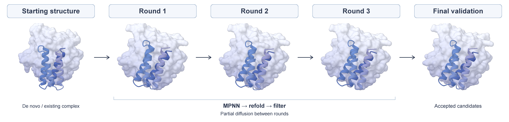

# Pipeline

Use `partidesign pipeline` for de novo molecular design or optimization of existing
complexes, from the first structures through iterative sequence/structure refinement
to final validation, in one command:

```bash
partidesign pipeline configs/examples/pipeline_tasks.yaml --task protdbench_insulin_receptor --preset ppi --run-name insulin_receptor
```

This insulin receptor binder task requests 32 initial backbones. The command
uses the PPI workflow below. Add `--config configs/pipeline/demo.yaml`
for a lighter final stage with five Mol-1 samples and the same production
candidate limits.

For the default PPI profile, prepare generation, MPNN, ESMFold2-fast, AF2,
Mol-1, AF3 and ESMFold2-standard assets; see
[model setup](download.md#optional-evaluation-models). Run from the repository root.
Add `--plan` for a short task/workflow preview or `--show-config` for the full
configuration used for diagnostics. Neither loads models nor creates run output.

The pipeline supports protein, peptide, RNA, DNA, VHH and VH/VL antibody design within each
backend's capabilities, including supported ligand context. Pure ligand design
uses [generation](design.md).

## Optimize existing structures

Pass a directory containing `annotation.csv` and the structures it lists:

```bash
partidesign pipeline configs/examples/optimization \
  --config configs/pipeline/optimize.yaml --preset ppi \
  --run-name peptide_optimization
```

The bundled directory contains complete linear and head-to-tail cyclic peptide
complexes. Binder chain `B` is redesigned and target chain `A` remains context.
The cyclic CIF already contains its terminal C–N bond. No input `result.csv` is
needed. Add `--task linear_peptides` or `--task cyclic_peptides` to select one
group, or `--plan` to preview both.

The directory workflow first creates partial-diffusion children around each
listed complex, retaining the original by default, then starts round 1.
It does not generate a new de novo structure first. Passed, rejected and
unfiltered structures can all be used: earlier scores and status do not decide
whether a seed is imported. The new predictions face the configured pipeline
criteria.

### Write annotation.csv

Each row describes one concrete starting complex. Only listed files are read;
there is no recursive directory search. CIF and PDB are accepted. PDB inputs
are converted to internal CIF once during import, preserving the available
identifiers and declared chemistry. The source files are not changed.

| Column | Meaning |
| --- | --- |
| `filename` | Required path to the full starting structure, relative to `annotation.csv`. |
| `task` | Shared candidate-pool name, default `optimize`. Select it with `--task`. |
| `sample_id` | Stable identifier within that task, default file stem. |
| `source_status` | Optional source label such as `passed` or `rejected`; does not filter inputs. |
| Native task fields | Use the ordinary `design_chains`, `condition`, `input`, `hotspot`, `crop`, `cyclic_offset`, `format`, `antibody`, `antigen` and other fields from the [task schema](task_schema.md). |

Structured cells use JSON. Numbers and booleans use JSON values such as `4`
and `true`; ordinary strings such as a hotspot selector can be written directly.
An empty cell omits the field; `null` retains the native field's explicit-null
meaning. CSV quoting doubles quotes inside JSON. For example, the `design_chains`
cell `[ {"B": "peptide"} ]` is written as `"[{""B"": ""peptide""}]"`.
The bundled [annotation.csv](../configs/examples/optimization/annotation.csv)
is a complete example.

These are native tasks, not a reduced set of annotation constraints. For example,
a `condition` cell can fix position 2 of the bundled linear peptide:

```json
{"sequence": {"B": [{"resid": 2, "residue": "K"}]}}
```

A residue or atom motif uses the same contig syntax as a YAML task:

```json
{"contig": {"B": {"token": "5/B6-8/11", "polymer_atom": {"B6": ["N", "CA", "C", "O"]}}}}
```

For an explicit terminal closure, use the existing bond endpoints:

```json
{"bond": [{"atom1": {"chain": "B", "resid": 1, "atom": "N"}, "atom2": {"chain": "B", "resid": -1, "atom": "C"}, "order": "single"}]}
```

Combine compatible entries within one `condition` object. Full and sparse fixed
sequences, modified CCD identities, backbone conditions, secondary structure,
motifs and chemical links have the same meanings as in YAML. Conditions must
match the actual seed; a fixed identity is not a request to substitute a
different residue before partial diffusion.

Unless supplied explicitly, a normal task's `input` is its seed structure.
Set `input` to the original source when a motif or other source condition
comes from a different file. All annotation file paths, including nested
antigen/scaffold and explicit partial paths, resolve relative to `annotation.csv`.
The original motif evaluation reference is kept separately from the current
complex used for partial and parent-relative consistency metrics.

Input special covalent links are retained as native constraints. Additional
links can be supplied through `condition.bond`; incompatible declarations are
an error. A disulfide retains its endpoint CYS identities, without fixing the
whole peptide. A cyclic offset and a terminal chemical bond remain separate
choices. Explicit leaving-atom rules and modified-component chemistry still use
the native bond schema. Fixed ligand context must include a complete molecular
graph with known bond orders, alongside its native ligand condition (such as
a trusted SMILES).

Actual sequences and lengths come from the structure. `design_length`, if
provided, must be compatible with those lengths; partial does not resample
lengths or invent missing geometry. A row's `sample_num` optionally overrides
its number of initial partial children. A row's `partial.fraction` overrides
its initial fraction; an explicit `partial.reference` must identify the same
structure as `filename`. A real `partial.result_csv` may restore saved mappings,
but is not required. Workflow-controlled scoring, reward/search and postprocessing
follow the same rules as the YAML pipeline.

### Shared pools and independent conditions

Rows in the same `task` share sequence deduplication, clustering, selection caps
and the final candidate pool. Use a group for seeds of the same optimization
problem, and separate groups for different targets or design roles. Each seed
and all its descendants retain their own molecular task, motif source, fixed
identities, topology and provenance. One row's conditions never replace another's.
Different structures with the same sequence remain valid partial starting
points; prediction-request deduplication still reuses identical model inputs.

Antibody rows use `format: antibody` plus the native `antibody` and `antigen`
objects, rather than ordinary `design_chains` and `condition` fields. Keep the
scaffold, VHH or VH/VL roles, mutable CDR/framework choices and antigen conditions.
Actual CDR layouts stay fixed across partial iterations. If several allowed
CDR lengths make the reference layout ambiguous, provide `partial.cdr_lengths`;
see [antibody partial diffusion](partial.md#antibody-references). Framework identity
permissions and soft template geometry keep their native meanings.

### Configure the initial step

[optimize.yaml](../configs/pipeline/optimize.yaml) inherits the selected preset's
native validation profiles and final methods. For protein and nucleic-acid tasks,
auto uses Mol-1, AF3 and ESMFold2-standard; native antibody tasks use their
ESMFold2-standard profile. The command above selects `ppi`, which also runs AF2-IG. It does not define a separate catalog of optimization thresholds.

```yaml
initial:
  partial:
    enabled: true
    fraction: 0.625
    replicas: 4
    include_parent: true
```

Without an explicit `initial.partial`, directory initialization inherits the
first round's partial settings. Global/per-task `initial.partial` overrides
those settings, then row `sample_num` and `partial.fraction` apply; explicit
`--partial-replicas` and `--partial-fraction` take final precedence over both
initial and inter-round partial settings. Row sampling overrides affect only
initialization. Set `initial.partial.enabled: false` to begin by refolding the
listed parents directly.

With the defaults, two seeds yield eight partial children plus two retained
parents: ten structures, up to twenty GT/MPNN proposals in round 1 before
deduplication. Initial partial is not a refolding round. Even with `recycle: 1`,
the directory path performs its configured initial partial, round 1 and final
validation; there is no inter-round partial or relax afterward.

## Antibody pipelines

Use the `antibody` preset for native `format: antibody` tasks; automatic preset
selection also chooses it for antibody YAML and antibody annotation rows.
The bundled GLP1R examples support both entry points:

```bash
partidesign pipeline configs/examples/antibody.yaml --task glp1r_vhh_bindcraft2 --preset antibody --run-name glp1r_vhh_denovo
partidesign pipeline configs/examples/antibody_opt --preset antibody --run-name glp1r_vhh_optimization
```

The de novo task requests five initial VHH backbones. The optimization directory
contains five fixed full complexes with binder `B` and antigen `A`; it starts
with four partial children per seed and retains the five parents. Both use three
rounds, GT1+MPNN1 in the first round, GT1+MPNN4 later, ESMFold2-fast iteration,
partial fraction 0.625, four replicas, parent retention and `relax: false`.
Final validation runs only ESMFold2-standard, with five samples of each selected
candidate’s current sequence and no further MPNN redesign. It selects the best
prediction by 0.8 ipTM + 0.2 pTM before filtering; a lower-ranked passing
prediction does not replace a failing winner. Prepare generation, MPNN,
ESMFold2-fast and ESMFold2-standard assets before execution.
ESMFold2 currently uses query-only inputs; the shared ColabFold MSA cache is
not yet passed into this backend.

For an antibody annotation, use these columns:

```csv
filename,task,sample_id,source_status,format,antibody,antigen,partial
```

The structured cells below are ordinary JSON objects; CSV quoting doubles the
quotes inside each object. The complete five-row
[annotation.csv](../configs/examples/antibody_opt/annotation.csv) is ready to use:

```json
{
  "antibody": {
    "scaffold": "bindcraft2_vhh",
    "chains": {"VHH": "B"},
    "template": true,
    "design": {"VHH": {
      "cdrs": ["CDR1", "CDR2", "CDR3"],
      "lengths": {"CDR1": "official", "CDR2": "official", "CDR3": "official"},
      "framework": "35/37/45/47/50/59/97-99/115-116"
    }},
    "paratope": {"VHH": {
      "cdrs": ["CDR1", "CDR2", "CDR3"],
      "framework": "26/34/51/58-59/95-96/115-116"
    }}
  },
  "antigen": {"input": "glp1r_vhh_01.cif", "crop": {"include": ["A"]}},
  "partial": {"cdr_lengths": {"VHH": {"CDR1": 7, "CDR2": 5, "CDR3": 25}}}
}
```

Here `filename` supplies the complete current partial reference; no external
`result.csv` is required. Scaffold coordinates remain a soft template, antigen
input supplies retained context, and mutable identities remain distinct from
intended contact residues. Keep actual CDR counts per seed. VHH uses one role;
paired antibodies keep both VH/VL roles and are evaluated as one binder.

Every antibody pipeline, including an explicit alternative preset, conjoins
`antibody_contacts` with the selected criteria on the same prediction. At least
seven unique antibody residues must contact antigen by a heavy-atom distance
≤4 Å, and at most 0.20 of contacting antibody residues may lie outside the
intended paratope. VH–VL internal contacts are excluded. The antibody profile
also requires RFD4 min iPAE and antigen-aligned binder RMSD each ≤3 Å during
iteration and each ≤2 Å at final validation. `criteria_mode: any` does not bypass the
contact rules. Thresholds can be customized through the existing
`presets.antibody_contacts` definition, using ordinary native criterion rules;
see [contact metrics](validate.md#antibody-contact-metrics).

## Default flow



Each round proposes sequences, refolds them and selects candidates for the next
step. Selected refold structures supply the reference for partial diffusion,
so subsequent rounds explore structures around the accepted candidates.

All presets use relaxed pipeline screening during iteration by default.
Original-reference motif geometry remains checked strictly at round 1 and final.

The default is three rounds, including the first validation round (`recycle: 3`):

```text
prepare required fixed-context MSA/templates
→ YAML: generate once using task sample_num / directory: initial partial + retained seeds
→ round 1: current sequence + MPNN1 → refold → filter → cluster
→ selected parent + four partial replicas
→ round 2: current sequence + MPNN4 → refold → filter → select
→ selected parent + four partial replicas
→ round 3: current sequence + MPNN4 → refold → filter → select
→ historical candidate pool → final validation
```

Here GT means the candidate's current sequence. Default iteration refolding is
ESMFold2-fast with one conformer per sequence. The first selection deduplicates
sequences and uses average-linkage clustering with an exact K=200 cut, keeping
the best candidate in each cluster; if fewer unique sequences pass, all remain.
Later rounds select the best child per immediate parent and deduplicate across
the task. Middle rounds forwarding candidates retain at most **two per partial
family**, then apply the task-wide cap of 200. A family is the previous selected
refold and its partial children. The last round has no family cap by default. Iteration
ranking uses **design-chain pLDDT**; context confidence is excluded.

Transitions use `fraction: 0.625`, four replicas and parent retention by default;
OpenMM is off. The last round has no inter-round transition, including when `recycle: 1`.
Directory initialization is a separate earlier step.
Original task conditions, fixed identities, motifs, context, and bonds remain
active as the current complex supplies the next partial-diffusion reference.

## Control candidate counts

The 32 initial InsR backbones are the start of the run. With the default
four partial replicas and `include_parent: true`, each selected refold supplies
up to **five input structures** to the next round. Each of those structures
then proposes GT1 plus MPNN4: up to **25 sequence proposals per selected refold**.
Partial failures, sequence deduplication and prediction-cache reuse can reduce
this work.

Later `per_parent: 1` selection applies to each immediate input structure, so
the retained refold and its four partial children are five separate parents.
In middle rounds, `per_family: 2` then keeps the two highest-scoring candidates
from that family after task-wide sequence deduplication. Set `per_family: null`
to disable this extra cap. First and last refolding rounds skip it by default;
set `rounds.N.selection.per_family` to apply it explicitly. Final validation
uses `final.pool` instead.

`max_pass: 200` caps the selected survivors **after refolding and filtering**;
it does not cap the number of sequence proposals submitted by that round.
With these defaults, 200 selected refolds can supply 1,000 structures and up to
5,000 sequence proposals to the next round. No partial replicas are generated
after the final round. Proposal totals describe the whole round; GPU workers
process them in batches or scheduled requests.

Use `summary.csv` to inspect proposal, prediction, selection, and partial
counts for your run.

## Final validation

By default, final validation uses the best eligible candidate seen across all
rounds for each lineage and refold profile. A **lineage** starts with a selected
round-1 refold and includes all its descendants. It stays the same across rounds;
a **partial family** groups a selected refold with its children for the next
round only. The family cap therefore does not set the final pool size.

The pool removes duplicate design sequences and keeps at most 200 candidates.
Each refold profile ranks its own candidates; the pool takes one from each
profile in turn until it reaches the cap or runs out. Set `final.max_pass` to
change this cap, or `final.pool.source: last` to use last-round survivors.

| Profile | Final prediction and acceptance |
| --- | --- |
| `protein`, `nuc` | Mol-1, AF3 and ESMFold2-standard (`methods: [mol1, af3, esmfold2-standard]`), five samples per model. Each selects its native best-ranked prediction, then applies its final criteria. |
| `antibody` | ESMFold2-standard only, five GT-only samples per selected candidate; select the best by 0.8 ipTM + 0.2 pTM before final criteria. |
| `ppi` | AF2-IG, Mol-1, AF3 and ESMFold2-standard (`methods: [af2_ig, mol1, af3, esmfold2-standard]`). Mol-1, AF3 and ESMFold2-standard each use five samples; AF2 models `[1, 2]` each use five matched complex/monomer pairs. AF2 selects each model's best complex by `0.8 * ipTM + 0.2 * pTM` with its same-sample monomer, and both model pairs must pass its internal filter. |

All configured methods run, and a candidate is accepted when **any method passes**.
`preset: auto` chooses antibody for native antibody tasks, otherwise protein or nuc; select `ppi` explicitly
for an eligible standard protein/peptide binder with protein context. Its AF2 final
criteria are `af2_ig_protdbench` for proteins and `af2_ig_peptide` for peptides.
AF2 produces ten pairs (twenty structures) per candidate with its default two
models, in addition to the Mol-1, AF3 and ESMFold2-standard predictions.
Use `final.method` to override the preset with a single method, or
`final.methods` to choose a method list.
ESMFold2-standard selects its best sample by `0.8 * ipTM + 0.2 * pTM`, then
applies the requested criteria. It uses the standard checkpoint and query-only
inputs; external MSA and templates are not supplied.
Prediction selection precedes criteria; a lower-ranked passing sample
does not replace a selected failing sample. All final structures remain in
`predictions/`. For each accepted candidate, `success/` contains every executed
method's best-ranked complex, including both AF2 model winners; matching monomers
remain in prediction evidence.

For example, keep the protein profile's iteration settings and change only final
validation in a workflow YAML:

```yaml
preset: protein
final:
  method: esmfold2-standard
  esmfold2: {samples: 5}
  criteria: [af3_basic]
```

ESMFold2-standard is included in the default `final.methods` for union filtering.
Each executed method still publishes its own best complex for accepted candidates.
The default iteration backend remains ESMFold2-fast.

The strict validation presets listed in [validate.md](validate.md) can be selected
with `final.criteria`. Their `pipeline_` variants are available for iteration
filters, for example `filter: [pipeline_af3_protein_bind_ligand_strict]`.
These variants multiply PAE and RMSD upper bounds by 1.5; pTM/ipTM, identity and
clash thresholds stay fixed. Explicit strict presets do not change the automatic
route defaults. Original-reference motif geometry is still checked at round 1
and final, with the existing protein/nucleic-acid limits, and omitted in middle
rounds.

Strict partner-aligned RMSDs support MPNN proposals. Unchanged residues retain
their all-atom comparison; redesigned protein residues use their conserved
backbone, and redesigned nucleotides use their sugar-phosphate framework.
The target fit and fixed/motif/bond constraints stay intact. This keeps every
designed position in the comparison without requiring reference coordinates for
new sidechains; see [validate.md](validate.md) for the recorded metric selection.

### Combine final filters

Set `final.methods` to run several independent final filters on the same pool.
A candidate is accepted when **at least one method passes**. Each method keeps
its own ranking and criteria, and all requested methods run. Use either
`method` for one backend or `methods` for several, never both:

```yaml
preset: ppi
final:
  methods: [af2_ig, mol1, af3, esmfold2-standard]
  af2: {models: [1, 2], samples: 5}
  mol1: {samples: 5}
  af3: {samples: 5}
  esmfold2: {samples: 5}
criteria_routes:
  protein:
    final:
      af2_ig: [af2_ig_protdbench]
      mol1: [af3_basic]
      af3: [af3_basic]
      esmfold2-standard: [af3_basic]
  peptide:
    final:
      af2_ig: [af2_ig_peptide]
      mol1: [af3_peptide]
      af3: [af3_peptide]
      esmfold2-standard: [af3_peptide]
```

For this combination, AF2 still requires both selected model pairs to pass its
own filter. That requirement does not make the four-method result an
intersection. To choose method-specific criteria, set `criteria_routes` as above.

There is one `final/success/` directory. For every union-accepted candidate it
contains each executed method's own best-ranked complex CIF, including a method
that failed its criteria. AF2 contributes the best complex for each configured
model. Filenames include the candidate, method and prediction key; matching AF2
monomers remain in prediction evidence. `success/result.csv` identifies each
published CIF and its method's pass status. `final/filter_results.csv` lists
candidate, method, criterion, metric value, comparison, threshold, and pass
status, alongside method and overall acceptance. Passing via one method does
not mean that all its published structures passed.

## Shared MSA and templates

Before GPU work starts, the workflow prepares the fixed-context MSA and protein
templates required by AF3/Mol-1. Protein searches default to ColabFold; designed
chains stay query-only. `--msa off` disables both MSA and templates. ColabFold
does not search RNA or DNA; use `source: af3` when fixed RNA context needs the
local RNA MSA search route. Structural templates apply only to fixed protein
chains. AF2-IG keeps its existing initial-guess protocol.

```yaml
msa:
  mode: auto
  source: colabfold
  max_template_date: "2021-09-30"
```

The pipeline handles preparation automatically. To fill or inspect the shared
cache separately, run:

```bash
partidesign msa configs/examples/pipeline_tasks.yaml \
  --task protdbench_insulin_receptor --config configs/pipeline/demo.yaml
```

Search results are shared at `<model_dir>/.cache/af3_msa/`. Identical queries
with the same search profile share one preparation across tasks, rounds and
final methods. The chosen cache generations stay pinned for the run and its
resumes. `--msa-refresh` refreshes each required query/profile once for a new
run; it does not repeat the search for each candidate or model.

The run's compact `msa.csv` lists chain/source, cache references, MSA depths and
template counts. Round and final directories do not contain duplicate search
caches. Each shared generation's `manifest.json` holds its template mappings and
provenance. See [MSA and templates](msa.md) for cache-only use, refresh, custom
service endpoints and local search resources.

## Results

New runs group results by task:

```text
inference/<run_name>/
  config.yaml                 # workflow configuration
  tasks.yaml                  # native task snapshot
  summary.csv
  msa.csv                     # shared MSA/template references and counts, when used
  <task>/
    design/                   # initial generation: result.csv and structures
    round_1/
      result.csv
      selection.csv
      refold/                 # authoritative passing candidate CIFs
      partial/<parent>/sample*.cif
      relaxed/                # optional whole-complex OpenMM
    round_2/...
    round_3/...               # no transition after the final iteration
    final/
      result.csv
      selection.csv
      predictions/            # all final samples/pairs; grouped by method for multi-final
      filter_results.csv      # multi-final: thresholds and method/overall acceptance
      success/                # accepted candidates and published best-ranked CIFs
  .work/                      # inputs, snapshots and resumable state
```

`config.yaml` is the pure workflow snapshot; `tasks.yaml` contains the selected
native tasks. `.work/` directories contain internal runtime files, including
`.work/resolved_config.yaml` for strict resume. Start with `summary.csv` for phase
counts and `msa.csv` for shared search inputs, then each phase's `result.csv` and
`selection.csv` for candidate outcomes and selection. For per-prediction metrics,
final model winners, and
rejection reasons, open `final/predictions/proposal*.json`; its
`prediction_selection` and `decisions` explain final acceptance. Multi-method
runs put these records under `final/predictions/<method>/`; start with
`final/filter_results.csv` to compare method outcomes.
Round and single-method final `result.csv` rows include `ipsae`,
`ipsae_design_to_context`, `ipsae_context_to_design`, `ipsae_pae_cutoff`, and
`ipsae_pairs` when the predictor supports them, for both passed and filtered
proposals. The three scores are in [0, 1] and use the maximum over eligible
design–context polymer pairs; design–design and context–context pairs are
excluded. Protein and RNA/DNA pairs, including atomized residues with resolvable
protein Cα or nucleic-acid C1′ representatives, are supported; ligand/ion pairs
are not applicable. AF2 does not calculate
ipSAE. These columns do not change ranking or passing criteria.
For multi-method finals, `final/result.csv` keeps each method's scores under
`<method>_metrics`; `final/success/result.csv` has the same ipSAE columns for
each published best-ranked CIF.
`result.csv` points to visible candidate CIFs. Iteration prediction artifacts
are under the round's `.work/predictions/`. To use a candidate as a
standalone partial start, supply its one `refold/*.cif` and define the new task's
conditions in YAML. To recover a previous run's resolved locators, pass its
round-level `result.csv` explicitly in `task.partial`; the pipeline handles this
metadata internally. Standalone validation can target a specific
`<task>/round_N` or `<task>/final` directory.

Check partial success/failure counts and final passing counts: a completed run
can have fewer rounds or no accepted final structure. With parent retention,
a selected parent can continue even when its partial children fail.

Completed runs remove raw prediction caches by default, preserving all
structures, final predictions, small metric records, resumable state, and input
snapshots. Add `--keep-cache` to retain raw prediction data and the request
cache for later PAE/PDE metric recomputation. This CLI flag controls retention
and does not belong in workflow YAML. Failed or interrupted runs retain caches.
ipSAE uses a default PAE cutoff of 10.0 Å. Missing PAE leaves scores unavailable
unless matching saved ipSAE evidence exists. Completed pipeline stages keep
their saved metrics on resume. For an existing standalone validation evaluation,
explicit `validate --recompute-metrics` can add ipSAE using its saved plan and
confidence data. It cannot recover missing PAE, and a changed cutoff cannot
reuse an old score.
A completed-stage `--resume` still reuses saved results; an invalidated stage
needs new predictions when its raw cache has been removed.

For eligible protein/peptide complexes, pass the run, task, `final/`, or
`final/success/` to [postfilter](postfilter.md). It screens only each published
final representative and checks its final acceptance evidence, including both
PPI model winners. For a multi-method final, only structures with
`method_passed=true` enter postfilter; other methods’ best CIFs remain comparison
evidence. The other final predictions and isolated monomers remain
validation evidence.

Directory-start runs replace each task's `design/` with:

```text
<task>/
  start/
    result.csv
    <sample_id>.cif
    partial/<sample_id>/sample*.cif
  round_1/ ... round_3/
  final/
```

The run saves `annotation.csv` instead of a de novo task-file snapshot. The
imported CIFs and resolved conditions form the run's input snapshot; per-seed
native authoring and recovery metadata stay under `.work/`. `start/result.csv`
is produced by import, not an additional input the user has to write.
All later round and final output conventions are shared.

## Tasks, presets, and workflow files

A task file describes the molecules and conditions. Keep it in the normal
[task schema](task_schema.md), for example `tasks.yaml`:

```yaml
my_protein:
  sample_num: 4
  design_chains: [{P: protein}]
  design_length: {P: [80]}
```

Use the same file and task selector for generation and the pipeline:

```bash
partidesign design tasks.yaml --task my_protein --run-name my_design
partidesign pipeline tasks.yaml --task my_protein --preset protein --run-name my_pipeline
```

Keep each task's usual `input`, conditions, crop, hotspots and bonds in this
native task file. `--task NAME` selects a task; repeat it to select several.
Omitting `--task` selects all tasks, each with its own candidates, counts and
outputs. The selected task's `sample_num` sets its initial generation budget.
Relative paths resolve from the invocation directory.

`--preset` chooses the workflow; `--config FILE.yaml` supplies separate workflow
overrides. Workflow presets and configuration examples live under
`configs/pipeline/`. The workflow file sets `preset`, `recycle`, operations under
`iteration` and `rounds`, and `final` controls. It is a plain top-level mapping,
without a `pipeline:` wrapper. Optional `tasks` entries in that workflow file
contain per-task workflow overrides, indexed by existing task names; molecular
task definitions stay in the native task file.

## PPI demos

The native task collection
[pipeline_tasks.yaml](../configs/examples/pipeline_tasks.yaml) works with both
`partidesign design` and `partidesign pipeline`. It contains only molecular
tasks; choose the pipeline workflow with `--preset ppi`:

| Task | Request |
| --- | --- |
| `protdbench_insulin_receptor` | Length-80 insulin receptor protein binder. |
| `protdbench_pdl1` | Length-80 PD-L1 protein binder. |
| `protdbench_bhrf1` | Length-80 BHRF1 protein binder. |
| `pepdbench_mdm2_linear` | Length-13 MDM2 linear peptide. |
| `pepdbench_mdm2_cyclic` | Length-13 MDM2 head-to-tail cyclic peptide. |
| `pepdbench_mdm2_disulfide` | Length-13 MDM2 disulfide peptide. |

These tasks retain the native benchmark crops and hotspots and each request
32 initial backbones. `--preset ppi` uses the general defaults: three rounds,
automatically routed iteration criteria, K=200 first selection, later
max-pass=200 and final max-pass=200.

The optional [demo workflow](../configs/pipeline/demo.yaml) keeps production
candidate limits with a lighter final stage. Iteration uses ESMFold2-fast and
relaxed `pipeline_protein_binder` / `pipeline_peptide_binder` screening. Final
validation uses **only Mol-1 with five samples**, selected by native ranking
before criteria. The workflow retains K=200 first selection, later max-pass=200
and final max-pass=200, three rounds, partial fraction 0.625 with four replicas
and parent retention, and relaxation off. Iteration and final prediction workers
each request one GPU. Prepare ESMFold2-fast and Mol-1 alongside generation and
auto MPNN. A task may end early or have no final pass.

```bash
partidesign pipeline configs/examples/pipeline_tasks.yaml --task protdbench_insulin_receptor \
  --preset ppi --config configs/pipeline/demo.yaml --run-name insulin_receptor_demo --plan
partidesign pipeline configs/examples/pipeline_tasks.yaml --task protdbench_pdl1 \
  --preset ppi --config configs/pipeline/demo.yaml --run-name pdl1 --plan
partidesign pipeline configs/examples/pipeline_tasks.yaml --task protdbench_bhrf1 \
  --preset ppi --config configs/pipeline/demo.yaml --run-name bhrf1 --plan
partidesign pipeline configs/examples/pipeline_tasks.yaml \
  --task pepdbench_mdm2_linear --task pepdbench_mdm2_cyclic --task pepdbench_mdm2_disulfide \
  --preset ppi --config configs/pipeline/demo.yaml --run-name mdm2 --plan
```

Remove `--plan` to run. Select one MDM2 task with its individual `--task` flag.
The cyclic task authors a real terminal C–N bond and cyclic offsets; the
disulfide task fixes both cysteines and their SG–SG bond. Mol-1 uses the explicit
C–N or SG–SG bond with its upstream positional encoding. The task's cyclic
offset remains available to generation, AF2-IG and AF3.

## Advanced workflow configuration

A workflow file needs only the settings you want to change. Leave other fields
out to inherit the preset. Use `null` only where it has a documented meaning,
such as disabling `per_family`; required numbers and booleans cannot be blank.
See `configs/pipeline/demo.yaml` for a runnable example. Molecular inputs belong
in the separate task YAML.

Put these operations under `iteration` in the workflow configuration; use the
same fields in `rounds.N` to change a particular round:

| Operation | Accepted input |
| --- | --- |
| `mpnn` | A proposal count, or `{source: auto, count: 4, settings: {...}}` with native MPNN settings. |
| `include_gt` | Boolean: propose the current sequence as well as MPNN sequences. |
| `refold` | A method string, or a mapping with `method`, `conformers`, native `af2`/`esmfold2`/`af3`/`mol1` settings and `worker_gpus`. |
| `filter` | A list of existing validation criterion names, or `{criteria: [...], criteria_route: auto, criteria_mode: all}`. |
| `selection` | `mode: cluster` or `top`, plus the limits described below. |
| `partial` | Boolean, or `{enabled: true, fraction: 0.625, replicas: 4, include_parent: true}`. |
| `relax` | Boolean: run whole-complex OpenMM before partial diffusion. |

Set `partial: false` to disable partial diffusion or `relax: true` to enable
whole-complex relaxation. The default fraction 0.625 runs the last 250 intervals
of the native 400-interval grid, starting at index 150; it is not an RMSD bound.
The pipeline fills `task.partial` from the selected refold and uses the same
runtime as [single-reference partial generation](partial.md). Existing
coordinate-condition sites take their restart coordinates from that complex;
original identity permissions and motif references are preserved.

MPNN `source` can be `auto`, `protein_mpnn`, `soluble_mpnn`, `ligand_mpnn`,
`cyclic_mpnn` or `na_mpnn`. Automatic routing follows native chemistry and model
capabilities. Fixed identities and motif permissions remain in force. Unsupported
redesign does not count repeated current sequences as new diversity.

For example, save this standalone binder workflow as
`configs/pipeline/custom.yaml`:

```yaml
preset: ppi
recycle: 3
iteration:
  mpnn: 2
  refold: esmfold2-fast
  filter: [af3_basic]
  selection: {max_pass: 16}
  partial: {replicas: 2}
rounds:
  1:
    mpnn: 1
    selection: {mode: cluster, num_clusters: 16}
  2:
    mpnn: {source: auto, count: 3}
final:
  max_pass: 8
```

Apply it to a task from the native collection:

```bash
partidesign pipeline configs/examples/pipeline_tasks.yaml --task protdbench_insulin_receptor \
  --preset ppi --config configs/pipeline/custom.yaml --run-name my_binder
```

For a per-task workflow change, add an override to that same workflow file:

```yaml
tasks:
  protdbench_insulin_receptor:
    iteration:
      mpnn: 2
```

The workflow's `tasks` mapping contains only workflow overrides. Keep molecular
fields in the native task YAML, without duplicating them here.

`final` accepts `method` or `methods`, native `af2`/`esmfold2`/`af3`/`mol1` settings,
`max_pass`, `criteria` and the native final-selection controls. For example,
`final: {method: af3, af3: {samples: 3}, max_pass: 8}` changes final prediction
sampling without changing iteration refolding. Mol-1 uses the same syntax:
`final: {method: mol1, mol1: {samples: 5}, max_pass: 8}`. Mol-1 shares the
AF3 context MSA/template cache; designed chains remain query-only. Native predictor settings are
listed in the [validation guide](validate.md).

Set ipSAE's PAE cutoff through the existing validation overrides, independently
for iteration and final prediction:

```yaml
iteration:
  refold:
    validation:
      ipsae: {pae_cutoff: 10.0}
final:
  validation:
    ipsae: {pae_cutoff: 10.0}
```

Use the same `refold.validation.ipsae` mapping under `rounds.N` for one round.
The [validation guide](validate.md#ipsae-interface-confidence) describes
directional scores, pair availability, and saved-evidence limits.

Settings resolve in this order:

```text
internal defaults → profile → common workflow → common round
→ task workflow → task round → explicit CLI within its documented scope
```

Most mappings merge field by field, and lists replace earlier lists.
**A `selection` block containing `mode` replaces the whole earlier selection
block**, even when the mode is unchanged. Omitted limits then use that mode's
defaults. For example, `{mode: top, per_family: null}` does not retain an earlier
`max_pass: 16`; include `max_pass: 16` again if you want to keep it.

To change just one limit, leave out `mode`. This round-2 override disables the
family cap while preserving the inherited `max_pass` and other selection fields:

```yaml
rounds:
  2:
    selection: {per_family: null}
```

`--method` and `--criteria` affect iteration;
`--final-criteria` affects final validation. `--first-mpnn-count` and
`--num-clusters` affect round 1; `--mpnn-count`, `--max-pass` and
`--max-pass-ratio` affect later rounds. `--recycle` sets the total round count.
Generation flags such as `--ckpt`, `--batch-size` and `--compile` keep their
native meanings.

The pipeline uses one Ray runtime with independent partial-diffusion, MPNN
and refolding worker pools. MPNN workers request 1 CPU and 0.0625 GPU each,
allowing up to 16 per GPU, further limited by parent count and available CPUs.
Each phase closes its workers and model cache before the next phase, so later
phases reload their models. `--worker-gpus` sets refolding resources; partial
workers independently request one GPU and `generation.num_workers + 1` CPUs
each. Both initial and inter-round partial diffusion retain the effective
`generation.batch_size` (set by `--batch-size`), regardless of parent count or
refolding budgets. For example, one parent with 20 replicas and batch size 16
runs as batches of 16 and 4.

## Selection controls

`selection.num_clusters` sets K for `mode: cluster`. For `mode: top`,
`per_parent` limits children per immediate input structure. Middle rounds also
use `per_family: 2` across a retained refold and its partial children; positive
integers change that cap and `null` disables it. First and last rounds omit the
family cap unless their round overrides set it explicitly. `max_pass` caps
task-wide survivors after these limits.
`max_pass_ratio` caps the fraction of unique proposed sequences before filtering;
when both limits are set, the smaller applies. There is no minimum-pass target
or backfill after a duplicate or transition failure.

For a maximum of five candidates per partial family in all three rounds:

```yaml
rounds:
  1: {selection: {per_family: 5}}
  2: {selection: {per_family: 5}}
  3: {selection: {per_family: 5}}
```

This keeps the inherited clustering and task-wide limits.

Deduplication preserves chain boundaries, modality and modified-residue tokens.
Legal cyclic rotations are equivalent only when motif and connection mappings
remain consistent. Clustering uses normalized token edit distance; multiple
design chains use their largest corresponding-chain distance.

## Criteria and ranking

Criterion names and native definitions come from
[`configs/criteria.yaml`](../configs/criteria.yaml), as in `partidesign validate`.
Automatic iteration screening uses relaxed versions of those rules. The
protein-binder screen uses `binder_iptm > 0.6`, `binder_ptm > 0.7` and
`complex_design_rmsd < 4 Å`; selected other geometric limits are 1.5 times their
native values. Identity, discrete and clash checks retain their native limits.
Linear and cyclic peptide binders use `pipeline_peptide_binder`: the same
`binder_iptm > 0.6` and `complex_design_rmsd < 4 Å`, plus
`rfd4_min_ipae_angstrom < 3.5 Å`, with no binder pTM gate.
Their AF3, Mol-1 and ESMFold2 final criterion is `af3_peptide`, which requires
min iPAE <1.5 Å; the PPI AF2 filter keeps `af2_ig_peptide`. Explicit peptide
chain labels are respected regardless of length. The demo uses the same relaxed
`pipeline_peptide_binder` iteration screen.
Explicit `filter: [af3_basic]` requests that existing strict criterion instead.
Its name does not select the prediction backend.

To skip general confidence and self-consistency quality thresholds during
iteration, select the native `blank` criterion:

```yaml
iteration: {filter: [blank]}
```

The CLI equivalent is `--criteria blank`. It uses one complex-scoped
`plddt >= 0` rule with `any_prediction` reduction; completed predictions with
finite pLDDT are still required. Original-reference motif gates at round 1 and
final, mandatory antibody contact checks, native identity and bond constraints,
deduplication, ranking and selection budgets remain active. Final validation
keeps the selected pipeline preset's criteria unless explicitly changed with
`--final-criteria` or `final.criteria`.

The pipeline normally requires all requested criteria on the same prediction.
Use `criteria_mode: any` in a filter mapping for a union. Additional native
`presets:` definitions can be supplied with `--presets FILE.yaml`. The PPI
protein AF2 final route preserves its intentional `all_and_mean` reduction for
`af2_ig_protdbench`; it is not an exact copy of every standalone reduction.

For coordinate motifs, new runs require the original-reference motif RMSD to
pass at **round 1 and final only**, against the original motif rather than the
current refold. Protein/peptide uses validate `af3_ame`'s
`motif_rmsd_reference <= 1.5 Å` rule; RNA/DNA uses validate `af3_na_motif`'s
`motif_rmsd_reference <= 3 Å` rule, selected by the design modality.
The gate remains mandatory with `criteria_mode: any`. If a task overrides
the applicable native rule, the gate uses its resolved value. Later iterations skip motif
RMSD computation, source-reference reads and motif-geometry filter rules; normal
confidence and self-consistency filters continue. Fixed motif identities,
conditions, role mappings and chemistry remain active in every round. A
sequence-only identity condition does not create a coordinate-motif gate.

Motif tasks retain design-only pLDDT ranking. Final prediction ranking happens
before the strict motif check, with the same no-fallback behavior described
under [final validation](#final-validation). Motif RMSD is a pass/fail check;
it does not change the ranking score.

Special polymer–polymer connections, including physical head-to-tail closures,
disulfides and staples, switch AF2-IG or AF3 iteration to ESMFold2-fast. Explicit
Mol-1 iteration keeps Mol-1 and uses its native covalent-bond input. Ordinary
backbone edges and offset-only intent do not trigger an override. Final
validation keeps its configured backend and [native chemistry limits](validate.md#antibodies-cyclic-peptides-and-modified-chemistry).
An iteration override does not extend AF2 final capabilities or add a final
bond-geometry criterion.

## Resume and reuse

To replay saved task and workflow snapshots, use a fresh run name from the same
invocation directory as the original run:

```bash
partidesign pipeline inference/my_run/tasks.yaml \
  --config inference/my_run/config.yaml --run-name replay
```

To resume, repeat the same command with `--resume`. Effective task and workflow
settings must match; changed settings need a new run. Retained prediction
evidence is reused for equivalent requests, while parent-relative metrics are recomputed.
Existing runs retain their legacy layout and saved checking policy on resume;
the first/final motif policy applies to new runs.

To start from saved generation, add `--from-run PATH` with the same native tasks;
upstream structures remain unchanged. Use a new run name for the pipeline's
outputs. See [partial generation](partial.md) when restarting from one actual
reference CIF without an iterative workflow.
